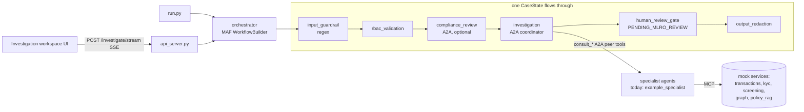

# ISTR Agent Mesh: FAB GERNAS AI-01 base codebase

A declarative agent mesh on **Microsoft Agent Framework (MAF, Python)** for ISTR (Internal Suspicious Transaction Report) investigations. An analyst opens a case; the mesh gathers cited evidence from specialist agents and returns a **draft** ISTR with status `PENDING_MLRO_REVIEW`. **Nothing is ever filed or sent.**

This is a foundation, not the finished use case. Its two key parts are:

1. **Agent Creation Template**: one folder per agent, `src/agents/<name>/` holding `agent.py` (Python entry point, `get_<name>_agent()`), `agent.spec.yaml` (configuration) and `prompt.md` (instructions). `scripts/new_agent.py` generates all three.
2. **Agent Factory**: `src/factory/`, which turns a spec into a running MAF `Agent` with its model client, tools, middleware, guardrails and memory.

Everything runs offline on synthetic data with the `stub` LLM provider, so no API key is needed.

**Agents:** the base ships with two **reference agents** only, `example_specialist` and `example_coordinator`. They show the folder structure and keep the pipeline runnable. The real ISTR agents are still to be decided; add them with the scaffolder and remove the examples when they are no longer needed.

> **Detailed guide:** [docs/BASE_CODE_GUIDE.md](docs/BASE_CODE_GUIDE.md) covers what is in the base code and step-by-step recipes for adding agents, tools, MCP services, middleware, guardrails, providers and workflow stages.

---

## Architecture



Each agent is its own A2A server process on its own port (`a2a_server.py --agent <node>`). MCP-backed agents hold their MCP sessions open for their lifetime, with retry/backoff and reconnect.

**Request flow:**

1. **Input guardrail.** Deterministic checks for injection, destructive intent and PII. A blocked input never reaches an LLM.
2. **RBAC.** Investigation roles only. Relationship managers are blocked because of the tipping-off risk.
3. **compliance_review.** Semantic review over A2A by the agent named in `WORKFLOW_COMPLIANCE_NODE`. It *fails closed*: if that agent is down, nothing runs. When the setting is empty (the default today), the step is skipped and the skip is logged.
4. **investigation.** The agent named in `WORKFLOW_COORDINATOR_NODE` (default `example_coordinator`) delegates to its peer agents and returns a summary plus an `ISTRDraft` JSON. Specialists stay thin and stateless. A down specialist becomes `<NODE>_UNAVAILABLE`, which is listed as missing evidence.
5. **human_review_gate.** Parses and validates the draft and forces `PENDING_MLRO_REVIEW`. It drops uncited findings and flags guilt, tipping-off and filing language as `review_issues`.
6. **output_redaction.** PII redaction on everything that leaves the mesh.

Stage and reasoning events stream over SSE for a live workflow view. Peer agents' `<llm_reasoning>` blocks are relayed through the coordinator, so the UI sees every agent.

---

## Quick start (offline, no API key)

```powershell
cd istr-agent-mesh
uv venv .venv --python 3.13            # or: py -3.13 -m venv .venv
uv pip install --python .venv\Scripts\python.exe --prerelease=allow -r requirements.txt
copy .env.example .env                 # LLM_PROVIDER=stub by default

.venv\Scripts\python -m pytest         # offline suite
.venv\Scripts\python scripts\smoke_test.py --all   # real processes: 5 MCP mocks + every agent, 3 cases
```

Interactive use:

```powershell
.venv\Scripts\python launch_mesh.py --with-mocks           # terminal 1: mocks + all nodes
.venv\Scripts\python run.py --case CASE-001 --stream       # terminal 2: CLI with live stages
.venv\Scripts\python api_server.py                         # optional: REST/SSE on :8000 (/docs)
.venv\Scripts\python devui_app.py                          # optional: single-process MAF DevUI on :8090
```

Sample cases (synthetic): `CASE-001` structuring + round-tripping (stub recommends **escalate**), `CASE-002` PEP-linked (**request_info**), `CASE-003` explained velocity spike, a false positive (**close**). Demo users: `analyst1`, `investigator1`, `mlro1`, `compliance1`, `admin1`. `rm1` is blocked by RBAC.

To use a real model, set `LLM_PROVIDER` plus a model and key in `.env` (see [Model providers](#model-providers)). Nodes fail fast at startup with a fix hint if anything is missing.

---

## Add a new agent in 5 minutes

```powershell
# 1. Scaffold. This validates against the whole mesh before writing anything.
.venv\Scripts\python scripts\new_agent.py trade_finance_review --kind mcp_thin `
    --tools "mcp:transactions[get_transactions|detect_patterns],a2a_peer:example_specialist" `
    --description "Reviews trade-finance flows for TBML red flags."
#    -> src/agents/trade_finance_review/{agent.py, agent.spec.yaml, prompt.md}, tests/agents/test_trade_finance_review.py
#    Port: next free (or --port). Use --dry-run to preview and --force to overwrite.

# 2. Fill the TODOs in prompt.md (ROLE, SCOPE, TOOLS, OPERATING RULES). The ISTR rules are injected automatically.
# 3. Trim `allow` lists to the minimum. Set the model profile, max_tool_calls and guardrails.
# 4. Connect it: let the coordinator delegate to it. Add to src/agents/example_coordinator/agent.spec.yaml
#    (or your own coordinator's spec):
#      - {type: a2a_peer, node: trade_finance_review, max_depth: 1}
#    For a new coordinator or safety guard, set WORKFLOW_COORDINATOR_NODE / WORKFLOW_COMPLIANCE_NODE instead.
# 5. Test and run. No registry edits are needed.
.venv\Scripts\python -m pytest tests\agents\test_trade_finance_review.py
.venv\Scripts\python a2a_server.py --agent trade_finance_review
```

`--tools` syntax: `mcp:<service>` (all catalog tools), `mcp:<service>[a|b]`, `a2a_peer:<node>`, `function:<pkg.module:attr>`.
Validation fails loudly on unknown tool refs or MCP tool names, unknown peers, port clashes, missing or incomplete prompts, unresolved `{{ vars }}`, unknown middleware or guardrails, and non-importable functions or schemas.

---

## Remove an agent

1. Remove its `- {type: a2a_peer, node: <name>}` line (and prompt mentions) from every agent that lists it.
2. If it is `WORKFLOW_COORDINATOR_NODE` or `WORKFLOW_COMPLIANCE_NODE` in `.env`, point that elsewhere (or empty the compliance one).
3. Delete `src/agents/<name>/` and `tests/agents/test_<name>.py`, plus any `<NAME>_*` / `PORT_<NAME>` lines in `.env`.
4. Run `pytest` and `scripts\smoke_test.py --all`.

If you forget step 1, the mesh refuses to start (`a2a_peer node '<name>' does not exist`). If you forget step 2, `launch_mesh.py` warns and `/health` reports `degraded`. Full details are in the [guide](docs/BASE_CODE_GUIDE.md#7-remove-an-agent).

---

## AgentSpec field reference

`src/factory/spec.py` defines the schema (pydantic v2, `extra="forbid"`, so typos are errors).

| Field | Type / values | Notes |
|---|---|---|
| `name` | snake_case | Node key. Must equal the directory name. Env prefix for overrides. |
| `public_name` | PascalCase | Agent name and A2A card name. |
| `description`, `version`, `owner` | str | Shown on the A2A card. `description` also describes `consult_<name>` to the coordinator. |
| `kind` | `specialist` \| `mcp_thin` \| `coordinator` \| `guardrail` | `mcp_thin` needs ≥1 mcp tool. `coordinator` needs ≥1 a2a_peer. `guardrail` has no tools. |
| `instructions_file` | path | Default `prompt.md`. Must have sections ROLE, SCOPE, TOOLS, OPERATING RULES, EVIDENCE & CITATION RULES, REFUSAL/ESCALATION, OUTPUT FORMAT, REASONING TRANSPARENCY. |
| `prompt_vars` | map | `{{ var }}` substitution. Built-ins: `name`, `public_name`, `description`, `tool_list`, `max_tool_calls`. |
| `includes` | list | Shared fragments from `src/agents/_shared/*.md`. Default `[istr_rules]`. |
| `model` | `{profile: default\|reasoning\|fast, provider?, model?, temperature?, max_tokens?}` | Env `<NODE>_PROVIDER/_MODEL/_API_KEY` wins. |
| `tools` | list of ToolRef | `{type: function, ref: "pkg.mod:attr"}` · `{type: mcp, service: transactions\|kyc\|screening\|graph\|policy_rag, allow: [...]}` (allow is **required**) · `{type: a2a_peer, node, max_depth: 1-5, description?}` |
| `middleware` | ordered names | `audit`, `tipping_off`, `pii_redaction`, `token_budget`. Default `[audit, tipping_off]`. The first entry is outermost. |
| `max_tool_calls` | int (15) | `token_budget` circuit breaker. MAF `max_function_calls` is set to +5 as a hard backstop. |
| `guardrails` | `{input: [...], output: [...], pii_redaction: bool}` | Checks: `prompt_injection`, `destructive_intent`, `pii`, `tipping_off`, `guilt_language`, `filing_action`. |
| `memory` | `{enabled, backend: jsonl\|redis, max_turns}` | Replayed per case/session by the orchestrator. |
| `output_schema` | dotted path | Its JSON schema is appended to the prompt (e.g. `src.schemas.istr.ISTRDraft`). |
| `reasoning_trace` | bool | Appends `_shared/reasoning_trace.md`. The agent self-identifies in `<llm_reasoning>`. |
| `a2a` | `{port, skills: [{id, name, description}]}` | `PORT_<NODE>` env overrides the port. |
| `observability` | `{span_name?, tags: []}` | Tags land in `Agent.additional_properties`. |

The factory always adds four middleware: `MeshContextMiddleware`, which restores the A2A depth, case and request headers (giving a cross-process loop guard and audit correlation without OTel); `GuardrailMiddleware` from `guardrails`; `PIIRedactionMiddleware`; and `ReasoningRelayMiddleware` on agents that have peers.

### Factory API

```python
from src.factory import AgentFactory
factory = AgentFactory()                                   # chat_client_factory=... to inject a fake
agent = factory.create("example_specialist")              # MAF Agent (MCP tools unconnected)
agent, public_name, description = factory.build_node("screening")
agent = factory.create_from_spec(spec, instructions="...")
factory.list_specs()
```

Each `src/agents/<name>/agent.py` exposes `get_<name>_agent(log_path=None, mcp_tools=None)`, the same shape as the reference repo's builders. It calls the shared factory, and is where agent-only Python tools live. `src/agents/node_registry.py` discovers the agent folders and derives `AGENT_REGISTRY` (pointing at each `get_<name>_agent`), `MCP_BACKED_NODES`, `NODE_NAMES`, `NODE_PORTS` and the start order.

---

## Model providers

| `LLM_PROVIDER` | Client | Needs |
|---|---|---|
| `stub` | Deterministic offline client (`src/factory/stub_client.py`) | Nothing |
| `openai_compat` | `OpenAIChatCompletionClient` + `LLM_BASE_URL` | `LLM_MODEL_*`, `LLM_API_KEY` (any non-empty value for local servers) |
| `azure_openai` | `OpenAIChatCompletionClient(azure_endpoint=...)` | `AZURE_OPENAI_ENDPOINT`, a deployment name in `LLM_MODEL_*`, a key or `AZURE_USE_ENTRA_ID=true` |
| `foundry` | `agent_framework.foundry.FoundryChatClient` | `agent-framework-foundry`, `azure-identity`, `FOUNDRY_PROJECT_ENDPOINT` |
| `anthropic` | `agent_framework.anthropic.AnthropicClient` | `agent-framework-anthropic`, `ANTHROPIC_API_KEY` |
| `ollama` | `agent_framework.ollama.OllamaChatClient` | `agent-framework-ollama`, `OLLAMA_HOST` |

Per-agent overrides: `ISTR_COORDINATOR_MODEL`, `SCREENING_PROVIDER`, `NARRATIVE_DRAFTER_API_KEY` and so on.

---

## Swapping mocks for real GERNAS services

Every data integration sits behind an MCP boundary, so going live only means changing `*_MCP_URL`:

| Service | Mock (`src/mock_services/`) | Real target |
|---|---|---|
| `transactions` | `transactions.py` (deterministic pattern rules) | GERNAS **SQL Agent** MCP |
| `kyc` | `kyc.py` | KYC/CDD system MCP (or the SQL Agent) |
| `screening` | `screening.py` | Screening platform MCP |
| `graph` | `graph.py` | GERNAS **Knowledge Graph** MCP |
| `policy_rag` | `policy_rag.py` (keyword retrieval) | GERNAS **RAG-as-a-Service** MCP |

1. Set e.g. `POLICY_RAG_MCP_URL=https://rag.internal/mcp` (and `MCP_API_KEY` if needed). The mock launcher skips remote URLs.
2. Update the tool names for that service in `src/integrations/mcp_catalog.py` to match the real server, then update the `allow` lists in the specs. The loader rejects any name that isn't in the catalog.
3. Keep the result contract: each record needs a `citations` entry `{tool, record_id, timestamp}`, or else adapt the prompts. ISTR rule 1 depends on it.

---

## What is real vs mocked

| Component | Status |
|---|---|
| MAF agents, middleware, function invocation, `WorkflowBuilder` graph | **Real** |
| A2A hosting and client (a2a-sdk, `A2AExecutor`, `A2AAgent`) | **Real** (localhost) |
| MCP transport (`MCPStreamableHTTPTool` ↔ FastMCP streamable HTTP, `allowed_tools`) | **Real** (localhost) |
| Spec loader, factory, scaffolder, guardrails, audit JSONL, memory (JSONL) | **Real** |
| LLM | **Mocked** by default (`stub`); real providers are pluggable |
| Transactions, KYC, screening, graph and policy data | **Mocked**: synthetic JSON in `data/synthetic/` |
| Identity / RBAC | **Demo** users in `src/auth/identity_provider.py` (replace with FAB SSO) |
| Redis memory backend | **Stub** (minimal, import-guarded) |
| OTel export / Opik | **Optional**: needs exporters installed and `OBS_PROFILE` / `OPIK_ENABLED` |

---

## ISTR-wide rules and where they are enforced

| Rule | Enforcement |
|---|---|
| 1. Evidence-grounded | `Finding.citations` has `min_length=1`. The gate drops uncited findings. Prompts include the rule. |
| 2. Draft only, human decides | `ISTRDraft.status` is a single-value `Literal`. The gate forces it. There are no outbound tools, and `tests/test_istr_rules.py` scans `src/` for them. `guilt_language` and `filing_action` checks run on outputs. |
| 3. No tipping-off | `tipping_off` middleware on every agent (negation-aware), plus gate checks, the optional semantic guard, and RBAC (no RM access) |
| 4. PII minimisation | `ENABLE_SENSITIVE_DATA=false` gives redacted, truncated audit records and no prompt content in traces. JSONL audit covers every agent run and tool call, correlated by request and case. |
| 5. Least privilege | Spec-only tools. MCP `allow` is required and catalog-checked, and MAF `allowed_tools` filters what the model sees. |
| 6. Deterministic before semantic | Workflow order (regex → RBAC → LLM guard) plus agent-level input guardrails |
| 7. Fail soft, not silent | `<NODE>_UNAVAILABLE` from peer tools, which the gate lists in `missing_evidence`. The coordinator being down produces an empty draft with issues. The compliance guard being down fails *closed*. |

---

## Observability

- `OBS_PROFILE=dev` uses MAF `configure_otel_providers()` (console/OTLP, e.g. Aspire or Jaeger). `prod` uses Azure Monitor if installed, otherwise falls back to dev. `off` keeps file logs only.
- Each node has its own service name (`istr_<node>`). W3C `traceparent` and baggage (`istr.case_id`, `istr.user`, `istr.role`, ...) propagate over A2A when `opentelemetry-instrumentation-httpx` is installed.
- Opik: set `OPIK_ENABLED=true` and install `opentelemetry-exporter-otlp-proto-http`. `src/observability/opik_setup.py` adds an OTLP exporter to Opik's OTel endpoint, so MAF's GenAI spans appear in Opik without code changes. It is import-guarded and optional.

---

## Tests

```powershell
.venv\Scripts\python -m pytest                    # 125 offline tests, ~15 s, no network/LLM
.venv\Scripts\python scripts\smoke_test.py --all  # multi-process A2A + MCP run of all three cases
```

Coverage: spec validation (good and bad), loader cross-checks, the scaffolder (dry run, write, force, failures), factory builds for every spec, model resolution and fail-fast, the registry, the tool resolver (function/MCP/peer and allow enforcement), middleware (audit, tipping-off incl. streaming, guardrails, PII, circuit breaker, depth), workflow gates and the draft-only guarantee, SSE events, memory, mock-service contracts, the API, and an in-process end-to-end run of all three cases.

---

## Notes on MAF API adaptation

The reference repo pinned older builds. These adaptations were verified against the installed packages (agent-framework-core 1.21, -a2a 1.0.0b261002, a2a-sdk 1.2, mcp 1.30):

- **`mcp<2` is required.** MAF's MCP client declares `mcp>=1.24,<2`, and mcp 2.x renames `FastMCP` to `MCPServer`. `requirements.txt` pins `mcp[cli]>=1.28.0,<2`.
- `MCPStreamableHTTPTool(allowed_tools=...)` is used for least privilege, rather than per-tool wrappers.
- The stub and fake chat clients compose `FunctionInvocationLayer + ChatMiddlewareLayer + ChatTelemetryLayer + BaseChatClient`, the same layering as `OpenAIChatCompletionClient`, so the framework's real tool loop runs.
- Optional provider extensions (foundry, anthropic, ollama) aren't installed here. Their constructors are called with only the kwargs their installed signature accepts. Verify them when you install the package FAB approves.
- `A2AExecutor` runs with its default `stream=False`, so output middleware sees the complete answer before it leaves a node.

## Layout

```
src/agents/        one folder per agent (agent.py + agent.spec.yaml + prompt.md; today: 2 reference agents),
                   node_registry.py, _shared/ prompt includes, _template/ scaffolder templates
src/factory/       spec, loader, model_clients, stub_client, tool_resolver, middleware_registry, agent_factory
src/a2a/           hosting (A2A server) + clients (ask_remote seam)
src/mesh/          workflow (executors), orchestrator, SSE events
src/middleware/    audit, tipping_off, guardrails/PII, token budget, mesh context + reasoning relay
src/guardrails/    deterministic filters
src/memory/        JSONL (default) + Redis stub
src/mock_services/ synthetic FastMCP services
src/schemas/       CaseFile, EvidenceItem, Finding, ISTRDraft
src/observability/ logging, OTel setup, baggage, Opik adapter
data/synthetic/    3 synthetic cases (no real data)
```
